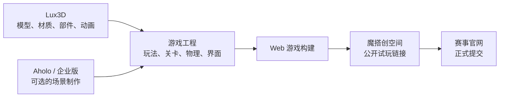

# 261026 AI 调研与头脑风暴

---
*探索一下Aholo Hackathon这个比赛，相关网址已经写在项目README中。可以查看一下提供哪些比赛资源、比赛的要求等。充分探索后，向我介绍一下在比赛过程中我能使用的资源、我最后应该形成一份怎样的作品，并简要地提供几种思路。*

**这是一场以 Aholo Lux3D 为核心、鼓励做出完整体验的 3D 创作赛。**我建议最终形成一个范围适中、可以直接体验的互动作品，同时准备项目报告和真实运行视频。选题应让评委很快看懂：Lux3D 带来了什么，以及作品哪里好玩。

以下信息按 **2026 年 10 月 26 日**的官方页面核对，覆盖了 README 中的四个入口，以及关联的 API、SDK、MCP、Viewer 和数据集文档。

先把比赛的边界弄清楚：

| 项目 | 官方要求或安排 |
|---|---|
| 形式 | 全球开放、线上参赛，支持 **1–3 人**；单人也需要创建团队 |
| 方向 | **不限方向、不给命题**，游戏、网页、影视、空间设计、3D 打印、具身智能等均可 |
| 必须使用 | **Aholo Lux3D 必须参与核心 3D 内容或关键创作流程** |
| 其他工具 | Aholo API、LuxReal，以及第三方创作和开发工具均可按需使用 |
| 截止时间 | **2026 年 11 月 19 日 19:00，北京时间**；团队成员也在此时锁定 |
| 后续 | 11 月 20–30 日评审，12 月初公布结果 |
| 奖励 | 总奖金池 **32 万元**，最高单项“3D AI 新物种奖”10 万元，另有综合奖、应用奖、创意奖和人气奖 |

游戏、影视等是应用奖的分类，并非限制选题的固定赛道。[来源：赛事官网](https://www.aholo3d.cn/hackathon)

评审重点也很明确：

| 维度 | 占比 | 对选题的实际影响 |
|---|---:|---|
| 群核技术栈应用 | 30% | Lux3D 应承担关键作用，报告中要能说明 |
| 有趣程度 | 25% | 交互、玩法和视频中的亮点很重要 |
| 创新性 | 20% | 需要有自己的概念或机制 |
| 完成度 | 20% | 核心流程完整，Demo 稳定可运行 |
| 传播 | 5% | 小红书发布，带 **#Aholo黑客松** |

最终得分由专家评委 **70%**、玩家评委 **30%**组成。我的判断是：**一个有鲜明记忆点、完成度高的小作品，会比功能繁多但体验松散的项目更符合这套评分。**[来源：评审规则](https://www.aholo3d.cn/hackathon)

你在比赛过程中可以使用的资源，比 README 的三个工具入口更丰富。

| 资源 | 已核实的能力 | 可以如何用到作品中 |
|---|---|---|
| **[Aholo Lux3D](https://lux3d.aholo3d.cn/lux3d/home)**，必用 | 图片或文字生成 3D 资产，生成几何和 PBR 材质，在线预览、GLB 导出；编辑器提供工作台和节点画布模式 | 游戏道具、角色、展品、产品模型、可交互物件 |
| **[Lux3D API](https://labs.aholo3d.cn/api-docs/intro#lux3d)** | 除生成外，还有材质重绘、部件拆分、关节化与动画、数字人绑骨、动画重定向、多格式导出 | 做成“生成后还能继续玩、改、拆、动”的应用 |
| **[World：世界生成与重建](https://labs.aholo3d.cn/api-docs/quickstart)** | 文字、单图或图文生成 3DGS 空间；多图、普通视频、Insta360 全景素材重建空间 | 给生成的物体提供可漫游的房间、展厅或故事场景 |
| **[Aholo Viewer](https://aholojs.dev/zh-CN/)** | MIT 开源的浏览器 3DGS 渲染器，支持多种格式、LOD、流式加载，以及碰撞和行走相关能力 | 在网页中展示和探索空间，加入拾取、导航、区域触发等交互 |
| **[RenderCloud](https://labs.aholo3d.cn/api-docs/intro#渲染云rendercloud)** | OpenUSD 离线出图、实时渲染流，以及 3DGS 与 Mesh 混合渲染 | 高质量产品展示、空间布置、镜头预览 |
| **[LuxReal](https://www.luxreal.com/create-video?createType=8)**，可选 | AI 视频创作 Agent；赛事介绍强调其时空一致性和内容可控性 | 影视类作品、故事片段、宣传视频 |
| **[InteriorGS 数据集](https://huggingface.co/datasets/spatialverse/InteriorGS)** | 1,000 个室内场景，超过 55 万个物体实例，附语义、包围盒、可通行区域和户型结构 | 空间理解、寻物、导航或具身智能原型 |

其中有几个会直接影响实现路线的细节：

- **单物体生成和空间重建是两种流程。**Lux3D 可从单图生成物体；World 的多图重建需要至少 **20 张图片**，也可使用视频。世界生成目前以室内效果更稳定，非室内仍处于 Beta。[快速开始](https://labs.aholo3d.cn/api-docs/quickstart)
- **不必全部手写 API。**官方提供 TypeScript、Python、Java SDK，也有 MCP 和 Skills，可让 AI 助手协助上传素材、提交生成、查询任务。渲染云目前需要直接接 API。[SDK 文档](https://labs.aholo3d.cn/api-docs/sdk)、[MCP 文档](https://labs.aholo3d.cn/api-docs/mcp)、[Skills](https://labs.aholo3d.cn/api-docs/skills)
- **InteriorGS 有专门的使用限制。**下载需要登录并接受条件；条款限定非商业科研、教育用途，禁止再分发下载的数据，要求适当引用。它适合研究原型，不能直接视为任意商用素材库。[数据集条款](https://kloudsim-usa-cos.kujiale.com/InteriorGS/InteriorGS_Terms_of_Use.pdf)
- **演示资产适合提前生成并保存。**生成是异步任务，SDK 文档还说明 Lux3D 结果下载地址有效期约两小时。提前保存关键模型，有利于稳定展示。[SDK 任务与产物说明](https://labs.aholo3d.cn/api-docs/sdk)

赛事本身还提供这些支持：

- **创作积分和算力：**报名成功领取个人积分；完成组队并提交选题后，团队积分平均分给当时的成员。团队奖励只在首次确认时发放，后加入者不补发。
- **魔搭 GPU 额度：**将作品发布至魔搭社区、在赛事官网提交有效链接，经核验符合要求后，可额外获得 **20 小时 Notebook GPU**。
- **培训与答疑：**官方社群、在线课程、Workshop。接下来有 **10 月 29 日线上说明会、10 月 31 日至 11 月 1 日北京站、11 月 7–8 日上海站、11 月 12 日线上冲刺活动**，报名信息在社群通知。[来源：赛事支持与活动安排](https://www.aholo3d.cn/hackathon)

公开页面没有给出具体积分数额、有效期，以及各服务额度能否通用；这些需要在报名后的“我的参赛”和官方社群中核对，不能按无限免费资源规划。

关于最终作品，我建议准备一个完整的提交包。

| 材料 | 官方性质 | 建议做到什么程度 |
|---|---|---|
| **项目报告书** | 必交 | 说明创意、目标体验、技术流程、Lux3D 的核心作用；包含过程截图、资产迭代对比或关键效果截图 |
| **完整 Demo** | 必交 | 核心流程能走通，有可体验或运行的成果 |
| **真实运行视频** | Demo 提交说明中涉及 | 允许剪辑、配音和字幕，必须包含真实运行画面 |
| **小红书发布链接** | 加分项 | 带 **#Aholo黑客松**，帖子保持公开至结果公布 |
| **源代码链接或压缩包** | 加分项 | 提供运行说明、依赖与资源来源，方便评审理解和复现 |

这里有一处表述值得留意：官网把 Demo 标成“**链接或视频**”，正文又分别提到体验链接和视频。**建议两者都准备**，能减少评委访问失败或不了解玩法的情况。[来源：提交要求](https://www.aholo3d.cn/hackathon)

报告可以按“**为什么做 → 怎么玩 → 怎么实现 → 资产如何迭代 → 最终效果与局限**”展开。篇幅和视频时长在我读取的公开说明中没有明确限制；作为制作目标，可以准备约 **6–10 页报告、2–3 分钟演示视频**，这是建议值。

作品本身建议收敛为：**一个核心机制、一个打磨好的场景、少量高质量资产、一次完整体验。**从第一天就保存输入图、生成结果、失败版本和修改截图，这些既能帮助迭代，也正好构成报告证据。

结合资源和评分，我比较看好以下几种思路；范围和难度是我的估计。

| 思路 | 核心体验 | Lux3D 如何承担核心作用 | 最小可交付范围 |
|---|---|---|---|
| **万物拆解实验室** | 把物体变成可拆解、观察、重新组装的 3D 谜题 | 生成物体，并结合部件拆分形成玩法 | 3 个精选物件、爆炸视图、组装挑战；需提前验证拆分质量 |
| **记忆修复屋** | 玩家把记忆中的物件放回房间，逐步解锁故事 | 生成承载故事的关键物件；可结合世界生成搭建房间 | 1 个房间、5 件物品、3 段故事 |
| **照片变桌面玩具擂台** | 将照片中的物体变成玩具，参与推挤、弹射或障碍挑战 | 生成的模型直接成为玩家操作的主体 | 单场景、2–3 个预制模型、1 种物理玩法 |
| **一句话搭建微型剧场** | 输入主题，生成道具、摆放舞台、选择镜头，产出一段小剧场 | 生成关键道具，结合渲染云或 LuxReal 输出内容 | 1 套舞台、3 件道具、少量固定镜头 |
| **空间寻物小助手** | 用户描述目标，助手在房间中指出物品并引导前往 | 用 Lux3D 生成任务物件，结合场景语义和导航交互 | 1 个场景、10 件物品、少量固定指令 |

**我优先推荐“万物拆解实验室”或“记忆修复屋”。**前者能较直接地体现生成、拆分与交互的结合；后者容易形成有情感记忆点的视频和完整体验。若选择擂台小游戏，也很适合快速做出可玩的版本。

现在距离截止约 24 天，比较合适的节奏是：先用两三天验证“生成资产进入作品”的完整流程，再锁定选题；中段完成核心玩法，最后一周集中做稳定性、报告、视频和发布材料。选题时最值得优先验证的，就是那个决定作品是否成立的核心机制。

---

*查一下这个比赛的往届背景，往届的作品有哪些类型？是不是游戏或者网页比较多？*

**就目前官网展示的案例而言，确实以小游戏和网页体验为主。**但需要区分：这些是官方展示的 Demo，不能当作“往届参赛或获奖作品”的统计。

我检索了中英文赛事名称、历届与获奖信息，**没有找到可核实的往届作品集或获奖名单**。目前能确认的是，本次赛事于 **2026 年 10 月 19 日启动**；同期报道还提到，Lux3D 于今年 8 月正式上线。这更像围绕新模型发起的早期开发者生态活动。不过，我没有找到明确的官方“首届”声明，因此不直接断言它此前从未举办。[赛事启动报道](https://www.iyiou.com/news/202610191143778)

官网“Aholo Lux3D，大家都是怎么玩的？”区域展示了以下五个不同案例：

| 官网案例 | 页面标注的类型 |
|---|---|
| 小精灵历险记 | 小游戏 |
| 飞行 | 小游戏 |
| 古村探险 | 小游戏 |
| 云水禅墟 | 网页制作 |
| 雪地房屋 | 场景还原 |

**五个案例中有三个小游戏、一个网页、一个场景还原，展示倾向很明显。**但页面没有标注它们的参赛届次、获奖情况或完整技术栈，不能进一步认定“三个游戏都是网页游戏”。[查看官网 Demo 区域](https://www.aholo3d.cn/hackathon)

我还找到一个可参考的实际黑客松项目：**[The Last Commit](https://devpost.com/software/the-last-commit)**。作者在 2026 年 10 月提交至 **Knight Hacks IX**，明确说明使用 Aholo 生成 3D 资产，再用 Unity、Blender 等搭建作品。它是一个“编程解谜＋奇幻冒险”游戏：玩家在倒计时内完成编程挑战，修复场景中的石柱，并获得 AI 熊猫伙伴的提示。它属于**其他赛事中的 Aholo 应用案例**，能说明这类工具如何进入游戏工作流，但不属于本次比赛的往届作品。

背景上，群核也曾为 **2026 年 8 月的 VentureD Hackathon**提供 Aholo 平台和算力支持。那是另一项独立赛事，同样不能算作 Aholo 全球 3D AI 黑客松的往届。[VentureD 官方回顾](https://venturedhackathon.com/services)

所以，对你选题更有用的判断是：

- **官方目前展示的样例偏向可玩、可漫游、视觉直观的体验。**小游戏是一个得到充分展示的方向。
- **“网页”和“游戏”并不互斥。**网页是交付载体，游戏是体验类型；空间叙事、教育工具、资产编辑器也都可以通过网页交付。
- **尚无历史获奖数据支持“做游戏更容易获奖”。**本届仍明确欢迎影视、空间设计、3D 打印和具身智能等方向。[官方方向说明](https://www.aholo3d.cn/hackathon)

**对你的项目，我会优先考虑“网页承载的 3D 互动作品”，再决定具体玩法。**它方便评委打开体验，也容易录制亮点视频。可以做游戏，也可以做拆解实验室、记忆空间或创作工具；选题的关键是让生成的 3D 资产真正参与操作、任务或故事推进。

---

*重读README，我新增了一些平台和参赛者手册内容。回答：假设我希望的参赛产出是一个游戏，游戏最终应该以怎样的形式呈现，如何发布？如何深度应用Aholo Lux3D平台？*

**建议把最终作品做成“浏览器打开即可玩的 3D 游戏”，主发布到魔搭创空间，再把试玩链接、项目报告和实机视频提交到赛事官网。**Lux3D 用来生产游戏核心资产，并进一步参与道具、机关、材质变化或角色动画的制作。

我已重读新增 README、参赛手册和平台文档。新手册明确允许使用自己熟悉的引擎、框架和第三方服务，并推荐将可运行 Demo 部署到魔搭创空间。[参赛手册](https://zhangqi.feishu.cn/docx/LQXOdudK5o4Mq9xsx83c5Doznof)

游戏最终应呈现为一段完整的可玩体验。对于这次比赛，我推荐：

- **电脑浏览器为主要体验端**，支持键鼠操作。
- 打开链接后有标题、简短操作说明和“开始游戏”。
- 提供约 **5–10 分钟**的完整流程：理解目标、操作、遇到挑战、完成目标、重新开始。这是建议规模。
- Lux3D 生成的核心物件应能被玩家操作，参与任务或关卡推进。
- 页面附上作品介绍、Lux3D 使用说明和演示视频入口，方便评委快速了解。

如果当前从零开发，我倾向于 **TypeScript＋Three.js＋GLB 资产**。Three.js 的 GLTFLoader 可以加载模型及动画资源，适合制作体量适中的网页游戏。[GLTFLoader 官方文档](https://threejs.org/docs/pages/GLTFLoader.html)

整体制作和发布关系如下：

**发布时，优先采用魔搭创空间的 Static（HTML）方式。**官方托管说明已经明确支持 Static、Docker、Gradio 和 Streamlit，因此网页游戏可以按自己的结构部署。[魔搭赛事作品部署与托管说明](https://modelscope.cn/posts/437204)

具体流程是：

1. **开发并构建游戏。**得到入口 `index.html`、JavaScript、样式以及模型、贴图、音效等资源。
2. **保存完整资产。**将生成结果下载并纳入游戏资源目录，发布版本使用自己保存的文件。
3. **在魔搭创空间创建项目。**纯前端游戏选择 Static（HTML），上传构建产物。
4. **设置公开访问并测试。**检查未登录、非本人账号能否打开，确认模型加载、鼠标控制、声音和完整通关流程正常。
5. **提交赛事材料。**将有效试玩链接登记到赛事官网，同时提交项目报告和包含真实运行画面的 Demo 视频。

如果游戏包含“玩家输入文字或上传图片，现场生成道具”的功能，就需要后端。此时选择 **Docker 部署**，由后端调用 Lux3D、查询任务、保存结果，再交给游戏加载。API Key 放在服务端环境变量中；项目中的 `keys.json` 用作本地凭据，不打包进前端。魔搭的托管说明也提供了环境变量配置方式。[部署说明](https://modelscope.cn/posts/437204)

手册特别明确：**赛事官网是唯一正式提交入口。**魔搭承担托管和传播；作品发布到魔搭并在赛事官网登记有效链接，经核验后还可获得额外 **20 小时 Notebook GPU**。报告推荐发布到灵感流，视频推荐发布到开发者实践。[手册中的魔搭资源说明](https://zhangqi.feishu.cn/docx/LQXOdudK5o4Mq9xsx83c5Doznof#WyeFdRaX4owBb2xbCGOcIENXn6e)

新增的 Aholo 企业版，可以用来制作关卡空间、分割物体、修补背景、组合模型和管理团队资产。它的分享链接用于在线查看场景；自定义的游戏规则、背包、关卡和胜负逻辑，需要在游戏工程中实现。企业版支持导出 PLY／SPZ，供支持高斯渲染的外部工具继续开发。[企业版分享与导出](https://aholo.demo.baklib.vip/a2523/b0ccc)

**深度应用 Lux3D，我推荐建立一条围绕玩法的资产生产流程。**

| Lux3D 能力 | 在游戏中的实际用途 |
|---|---|
| 图生／文生 3D、多视图输入 | 制作玩家反复使用的主道具、关键机关、主要角色，统一视觉风格 |
| 重拓扑、贴图烘焙 | 控制模型复杂度，将生成资产加工成适合网页运行的版本 |
| 材质重绘 | 制作木、金属、陶瓷等状态，配合游戏中的属性变化、修复或升级 |
| 部件拆分 | 制作拆解、组装、零件收集和机械维修玩法 |
| 关节化 | 为箱盖、门、机械臂等生成运动效果，再接入交互触发 |
| 自动绑骨、动画重定向 | 为符合条件的人物模型制作待机、行走、拾取等动作 |

这些能力已在当前 Lux3D 开发文档中列出。需要注意制作顺序：**先完成静态模型的重拓扑，再做绑骨和动画**，因为重拓扑接口目前只接受静态 GLB。[Lux3D 开发文档](https://lux3d.aholo3d.cn/lux3d/doc?lang=zh_CN)

例如，材质变化可以成为一个明确的玩法：玩家将物件转为金属状态后，用它接通电路；转为木质状态后，用它完成另一种挑战。Lux3D 负责各状态的视觉资产，导电、重量、可燃等属性由游戏规则配置。这样，生成资产就与玩家决策建立了关系。

制作阶段深度使用 Lux3D，已经符合赛事所说的“参与核心 3D 内容或关键创作流程”。**实时生成可以按玩法需要加入。**手册给出的生成耗时是极速版通常约一分钟、普通版约三到五分钟，因此适合放在“造物台、关卡之间、创作模式”等允许等待的位置。[手册中的调用说明](https://zhangqi.feishu.cn/docx/LQXOdudK5o4Mq9xsx83c5Doznof#DAzYdGuw3ofBWIxhlS6cJIElnbd)

我推荐先完成固定资产的可玩版本，再增加一次真实生成体验。这样，评委打开游戏后能立即开始玩，也能看到生成能力怎样扩展游戏内容。

如果使用 SpatialGen 或 Reality 制作整个房间，还需要处理场景碰撞。3DGS 提供空间外观，行走、阻挡和拾取需要额外生成或配置体素、网格碰撞数据。[Aholo Viewer 碰撞文档](https://aholojs.dev/zh-CN/manual/physics-collision/)

**具体到选题，我推荐“一间房里的造物解谜游戏”。**玩家拆解装置、收集零件、改变物件材质、启动机关，最终修复机器或离开房间。首版可以控制在一个场景、三组谜题、六到十件核心物品。

这能让 Lux3D 的模型生成、材质重绘、部件拆分和关节化都服务于同一套玩法。开发过程中保存“参考图 → 初版模型 → 迭代结果 → 游戏内交互”的对照，再记录模型面数、加载表现和关键任务 ID，就能清楚地向评委展示平台贡献。
